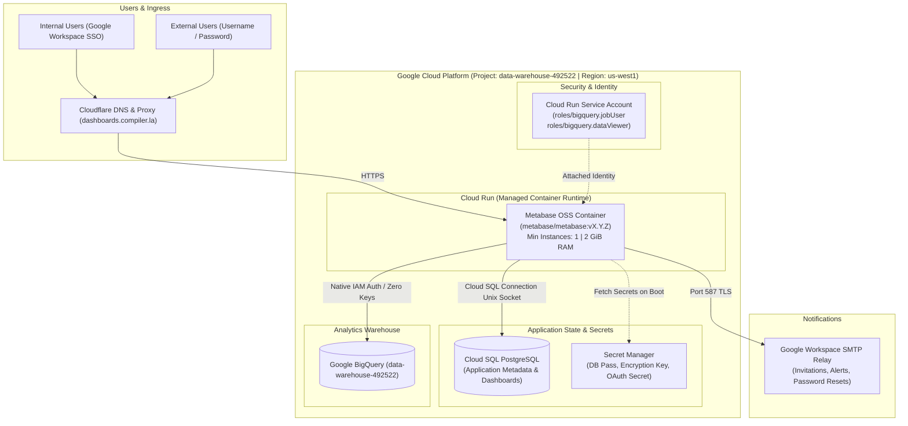

# Project Architecture

This section explains the reasoning behind our design choices.

## Architecture Overview

## Key Architecture Decisions

| Component                | Selected Configuration                 | Rationale                                                                                                                                      |
| :----------------------- | :------------------------------------- | :--------------------------------------------------------------------------------------------------------------------------------------------- |
| **GCP Project**          | `data-warehouse-492522`                | Host project containing BigQuery analytics warehouse and infrastructure.                                                                       |
| **GCP Region**           | `us-west1` (Oregon)                    | Optimal low-latency to California; standard Tier 1 GCP pricing (matches `us-central1` costs).                                                  |
| **Domain & DNS**         | `dashboards.compiler.la` (Cloudflare)  | Free managed SSL certificates; CNAME pointing to Cloud Run; proxy/WAF protection.                                                              |
| **Container Runtime**    | **GCP Cloud Run**                      | Zero Kubernetes overhead; fully managed container lifecycle; integrated Cloud SQL proxy; native HTTPS.                                         |
| **Instance Policy**      | **Min Instances: 1**                   | Prevents cold-start delays and ensures Metabase background syncs, alerts, and scheduled pulses run continuously.                               |
| **Application Database** | **Cloud SQL PostgreSQL**               | Production-ready state store for Metabase (dashboards, queries, users, permissions). Never use the default embedded H2 database in production. |
| **Analytics Warehouse**  | **Google BigQuery**                    | Native driver built into Metabase. Authenticated via the Cloud Run attached Service Account (no JSON key rotation needed).                     |
| **Authentication**       | **Dual Auth: Google OAuth + Password** | Google Workspace OAuth restricted to `@compiler.la` for internal staff, plus password invites enabled for external stakeholders.               |
| **Outbound Email**       | **Google Workspace SMTP Relay**        | Reliable delivery of user invitations, password resets, and automated dashboard subscriptions.                                                 |
| **Secrets Management**   | **GCP Secret Manager**                 | Securely injects database passwords, encryption keys, and client secrets directly into container environment variables.                        |
| **IaC & Automation**     | **Terraform + GitHub Actions**         | Fully reproducible infrastructure; automated `terraform plan` on Pull Requests and `terraform apply` via release tagging.                      |
| **Local Development**    | **VS Code Dev Containers**             | Cross-platform consistency across Linux, macOS, and Windows matching `compilerla` Dev Container standards.                                     |
