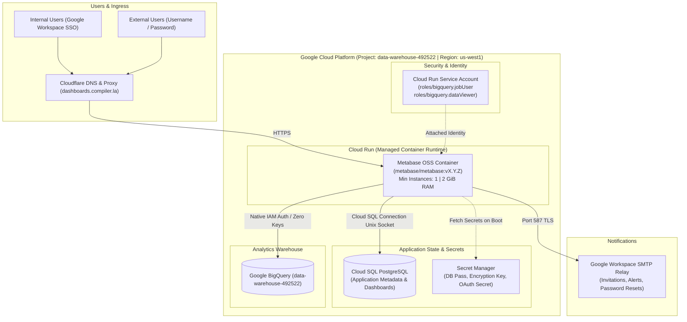

# Metabase OSS Implementation Plan: GCP Cloud Run & Docker

This document outlines the end-to-end architecture, repository structure, and phased implementation plan for deploying an open-source **Metabase** instance on **Google Cloud Platform (GCP)** without Kubernetes overhead.

---

## 1. System Architecture



---

## 2. Key Architecture Decisions

| Component                | Selected Configuration                 | Rationale                                                                                                                                      |
| :----------------------- | :------------------------------------- | :--------------------------------------------------------------------------------------------------------------------------------------------- |
| **GCP Project**          | `data-warehouse-492522`                | Host project containing BigQuery analytics warehouse and infrastructure.                                                                       |
| **GCP Region**           | `us-west1` (Oregon)                    | Optimal low-latency to California; standard Tier 1 GCP pricing (matches `us-central1` costs).                                                  |
| **Domain & DNS**         | `dashboards.compiler.la` (Cloudflare)  | Free managed SSL certificates; CNAME pointing to Cloud Run; proxy/WAF protection.                                                              |
| **Container Runtime**    | **GCP Cloud Run**                      | Zero Kubernetes overhead; fully managed container lifecycle; integrated Cloud SQL proxy; native HTTPS.                                         |
| **Instance Policy**      | **Min Instances: 1**                   | Prevents cold-start delays and ensures Metabase background syncs, alerts, and scheduled pulses run continuously.                               |
| **Application Database** | **Cloud SQL PostgreSQL**               | Production-ready state store for Metabase (dashboards, queries, users, permissions). Never use the default embedded H2 database in production. |
| **Analytics Warehouse**  | **Google BigQuery**                    | Native driver built into Metabase. Authenticated via the Cloud Run attached Service Account (no JSON key rotation needed).                     |
| **Authentication**       | **Dual Auth: Google OAuth + Password** | Google Workspace OAuth restricted to `@compiler.la` for internal staff, plus password invites enabled for external stakeholders.               |
| **Outbound Email**       | **Google Workspace SMTP Relay**        | Reliable delivery of user invitations, password resets, and automated dashboard subscriptions.                                                 |
| **Secrets Management**   | **GCP Secret Manager**                 | Securely injects database passwords, encryption keys, and client secrets directly into container environment variables.                        |
| **IaC & Automation**     | **Terraform + GitHub Actions**         | Fully reproducible infrastructure; automated `terraform plan` on Pull Requests and `terraform apply` on merge to `main`.                       |
| **Local Development**    | **VS Code Dev Containers**             | Cross-platform consistency across Linux, macOS, and Windows matching `compilerla` Dev Container standards.                                     |

---

## 3. Recommended Repository Structure

```text
.
├── .devcontainer/
│   ├── devcontainer.json            # VS Code dev container definition
│   ├── Dockerfile                   # Developer environment image (Terraform, gcloud, pre-commit)
│   └── postCreate.sh                # Container initialization & hook setup
├── .github/
│   └── workflows/
│       ├── terraform-plan.yml       # Runs on pull requests to validate & plan
│       └── terraform-apply.yml      # Runs on merge to main to apply infrastructure
├── bin/                             # Helper bash scripts for inside the dev container
├── compose.yml                      # Dev container service + local Metabase & Postgres
├── .env.example                     # Sample local environment variables
├── .pre-commit-config.yaml          # Conventional commits & file hygiene hooks
├── terraform/
│   ├── main.tf                      # Cloud provider, backend configuration
│   ├── variables.tf                 # Environment variables and configurable parameters
│   ├── outputs.tf                   # Outputs (Cloud Run URL, Cloud SQL connection name)
│   ├── cloud_run.tf                 # Cloud Run service, env vars, scaling, and secrets
│   ├── cloud_sql.tf                 # Cloud SQL PostgreSQL instance and database
│   ├── iam.tf                       # Service account and BigQuery / Secret Manager roles
│   ├── secrets.tf                   # Secret Manager resources
│   └── terraform.tfvars.example     # Template for project-specific variables
└── README.md
```

---

## 4. Phase 1: Dev Container & Local Development

Following the `compilerla` pattern:

- **`compose.yml`** orchestrates three services:
  1. `dev`: VS Code developer container mounting the repository at `/home/compiler/src`, running as user `compiler`.
  2. `metabase`: Official Metabase Docker container connected to local Postgres.
  3. `postgres`: PostgreSQL 16 backing Metabase application state.
- **`.devcontainer/devcontainer.json`** configures VS Code extensions (`hashicorp.terraform`, `gitlens`, `prettier`, etc.) and sets the default terminal profile.
- **`.devcontainer/Dockerfile`** installs developer tools: Terraform/OpenTofu, Google Cloud CLI (`gcloud`), `pre-commit`, and Postgres client utilities.

---

## 5. Production Configuration Details

### 5.1 Cloud Run Sizing & Environment Variables

- **CPU & Memory**: 1 vCPU, 2 GiB RAM (can scale to 2 vCPU / 4 GiB if user concurrency grows).
- **Scaling Rules**: `min_instances = 1`, `max_instances = 3`.
- **Container Concurrency**: 80 concurrent requests.
- **Essential Environment Variables**:
  - `MB_DB_TYPE`: `postgres`
  - `MB_DB_DBNAME`: `metabase`
  - `MB_DB_USER`: `metabase`
  - `MB_DB_PASS`: Secret reference from Secret Manager.
  - `MB_DB_HOST`: `/cloudsql/data-warehouse-492522:us-west1:metabase-db` (Unix domain socket).
  - `MB_ENCRYPTION_SECRET_KEY`: 32+ character key from Secret Manager (used to encrypt data source credentials stored in Metabase).
  - `MB_SITE_URL`: `https://dashboards.compiler.la`
  - `JAVA_OPTS`: `"-Xmx1536m -Xms512m -XX:+UseG1GC"` (Allocates appropriate JVM heap within the 2 GiB container limit).

### 5.2 BigQuery Authentication

- Dedicated Service Account: `metabase-runner@data-warehouse-492522.iam.gserviceaccount.com`.
- IAM roles granted:
  - `roles/bigquery.jobUser` (permits executing queries).
  - `roles/bigquery.dataViewer` (permits reading analytical datasets/tables).
  - `roles/cloudsql.client` (permits connecting to Cloud SQL via unix domain socket).

### 5.3 Ingress & Cloudflare DNS

1. In GCP Cloud Run, configure Custom Domain Mapping for `dashboards.compiler.la`.
2. In Cloudflare DNS:
   - Create a `CNAME` record: `dashboards` -> `ghs.googlehosted.com`.
   - Proxy status: Proxied with Cloudflare SSL set to **Full (Strict)**.

---

## 6. Phased Implementation Roadmap

1. **Phase 1: Dev Container & Local Development**:
   - Set up `.devcontainer/devcontainer.json`, `.devcontainer/Dockerfile`, `compose.yml`, and `.env.example`.
   - Verify Metabase runs locally on port 3000 backed by Postgres.
2. **Phase 2: Terraform Infrastructure**:
   - Define Cloud SQL PostgreSQL, Secret Manager, IAM roles, and Cloud Run service in `us-west1`.
3. **Phase 3: CI/CD & DNS**:
   - Set up GitHub Actions with GCP Workload Identity Federation (WIF).
   - Configure Cloudflare DNS CNAME for `dashboards.compiler.la`.
4. **Phase 4: Metabase App Setup**:
   - Configure Google Workspace OAuth and SMTP relay.
   - Connect BigQuery datasets and establish permission groups.
5. **Phase 5: Backup & Upgrade Runbooks**:
   - Document automated backup verification and container image bump process.
